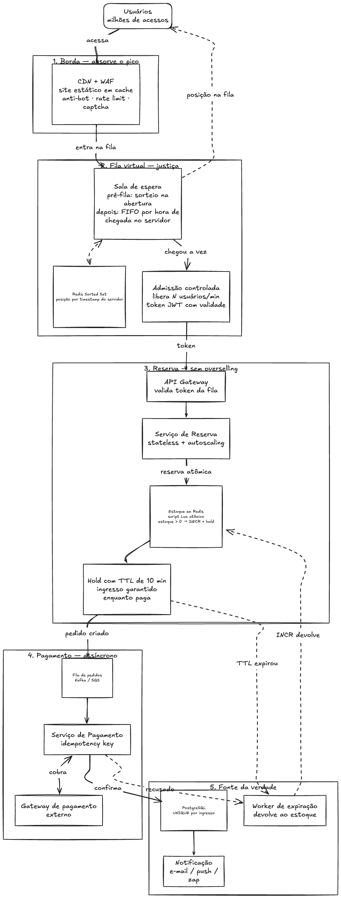

# Arquitetura — Venda de ingressos de alta concorrência

## Os dois problemas

1. **Não vender mais ingressos do que existem** (overselling), mesmo com milhões de acessos simultâneos.
2. **Justiça**: quem tem internet mais lenta não pode perder a vez para quem tem internet mais rápida.

## Como a arquitetura resolve

### 1. Borda — absorver o pico
- O site é estático e servido por **CDN**: o pico de acessos bate no cache, não nos servidores.
- **WAF** com proteção anti-bot, rate limit e captcha filtra tráfego automatizado antes de chegar à fila.

### 2. Fila virtual (Waiting Room) — justiça
- Todo usuário entra numa **sala de espera** antes de acessar a compra.
- Quem chega **antes da abertura** entra numa pré-fila e, na abertura, recebe uma **posição por sorteio**. Assim, ninguém ganha por ter apertado F5 com a conexão mais rápida.
- Quem chega **depois da abertura** entra em **FIFO pela hora de chegada registrada no servidor**, não pela velocidade de resposta do cliente.
- A posição fica num **Redis Sorted Set**; o cliente só faz polling leve/SSE para acompanhar a posição, o que funciona bem até em conexões lentas.
- A **admissão é controlada**: só N usuários por minuto saem da fila, de acordo com a capacidade do backend. Cada um recebe um **token assinado (JWT) com validade**.

### 3. Reserva — sem overselling
- O **API Gateway** só aceita requisições com token válido da fila. Sem token, a resposta é 403, então ninguém pula a fila chamando a API direto.
- O **Serviço de Reserva** é stateless e escala horizontalmente.
- O estoque fica no **Redis** e é decrementado por um **script Lua atômico**: "se estoque > 0, decrementa e cria o hold; senão, esgotado". Como o Redis executa o script de forma atômica, duas pessoas nunca pegam o último ingresso.
- O ingresso fica em **hold com TTL** (ex.: 10 min) enquanto o usuário paga. Ele já está garantido para aquela pessoa, então uma conexão lenta no checkout não faz ela perder o ingresso.

### 4. Pagamento — assíncrono e resiliente
- O pedido vai para uma **fila de mensagens** (Kafka/SQS), desacoplando a reserva do pagamento e absorvendo instabilidades do gateway externo.
- O **Serviço de Pagamento** usa **idempotency key** por pedido, então retentativas nunca cobram duas vezes.

### 5. Fonte da verdade e devolução de estoque
- A venda só é confirmada numa transação no **PostgreSQL**, com **constraint UNIQUE por ingresso** como última garantia contra venda duplicada.
- Um **worker de expiração** devolve ao estoque (INCR no Redis) os ingressos com hold vencido ou pagamento recusado, e o próximo da fila pode comprá-los.
- Após a confirmação, o serviço de **notificação** envia o ingresso por e-mail/push ou pelo zap.

## Resumo

| Requisito | Solução |
|---|---|
| Aguentar o pico | CDN + fila virtual + admissão controlada + serviços stateless com autoscaling |
| Não vender além do estoque | Decremento atômico no Redis (Lua) + UNIQUE no banco |
| Justiça com internet lenta | Posição definida no servidor (sorteio na abertura, depois FIFO) + hold com TTL durante o pagamento |
| Pagamento confiável | Fila de mensagens + idempotência + devolução automática do estoque |